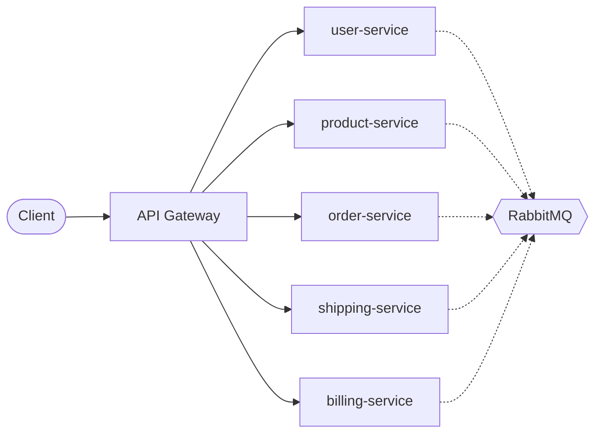
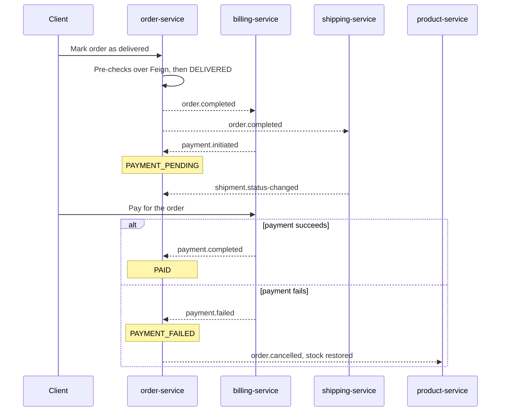

# Engaz

**An Amazon-style e-commerce backend built as six Spring Boot microservices.**

Engaz covers the full path of an online order: sign-up, catalogue and search, ordering, shipping, payment, and refunds. Each service owns its own database, services talk to each other over REST (OpenFeign) and events (RabbitMQ), and a payment saga keeps orders, stock, shipments, and transactions consistent without a shared database.

Built by a team of 15 at the German University in Cairo (Spring 2026).

## Contents

- [Architecture](#architecture)
- [Services](#services)
- [The order and payment saga](#the-order-and-payment-saga)
- [Tech stack](#tech-stack)
- [Engineering highlights](#engineering-highlights)
- [Getting started](#getting-started)
- [Observability](#observability)
- [Team](#team)

## Architecture



- **API Gateway** (Spring Cloud Gateway) is the single entry point. It validates the JWT, attaches a correlation ID, and routes by path.
- **Synchronous calls** between services use OpenFeign clients defined once in a shared `contracts` module.
- **Asynchronous events** flow through RabbitMQ topic exchanges, one per service (`order.events`, `payment.events`, `shipment.events`, `product.events`, `user.events`).
- **No service reads another service's tables.** Every cross-service read is a Feign call and every cross-service write is an event.

## Services

| Service | Responsibility | Data stores |
|---|---|---|
| **api-gateway** | JWT validation, routing, correlation IDs | none |
| **user-service** | Registration, login, roles, shipping addresses, preferences, activity feed | PostgreSQL, MongoDB, Redis |
| **product-service** | Catalogue, reviews and ratings, stock, full-text search, catalogue dashboard | PostgreSQL, MongoDB, Redis, Elasticsearch |
| **order-service** | Order lifecycle, estimates, analytics, "customers also bought" recommendations | PostgreSQL, MongoDB, Redis, Neo4j |
| **shipping-service** | Shipments, carrier performance, delayed-shipment reports, tracking timeline | PostgreSQL, MongoDB, Redis, Cassandra |
| **billing-service** | Transactions, vouchers, full and per-item refunds, revenue reports | PostgreSQL, MongoDB, Redis |
| **contracts** | Shared DTOs, event records, and Feign client interfaces | none |

Each store is used for what it is good at:

- **PostgreSQL** (one instance per service): the source of truth, with JSONB columns for flexible metadata.
- **MongoDB**: an append-only event log per service (auth events, order events, transaction audit trail).
- **Redis**: read caching with per-feature TTLs and pattern-based invalidation on writes.
- **Elasticsearch**: full-text product search with category, brand, price, and rating filters.
- **Neo4j**: a `BOUGHT_TOGETHER` graph that powers product recommendations.
- **Cassandra**: shipment tracking events, partitioned by shipment and ordered newest first.

## The order and payment saga

An order moves through these states:

`PENDING → CONFIRMED → SHIPPED → DELIVERED → PAYMENT_PENDING → PAID`

with `PAYMENT_FAILED`, `REFUNDED`, and `CANCELLED` as the failure and compensation paths.

The saga is choreographed: there is no central orchestrator, and each service reacts to events.



Earlier in the flow, confirming an order publishes `order.placed`, and product-service deducts stock for each item.

What keeps the saga safe:

- **Pre-checks before any write.** Delivery is rejected unless the user is still active, every product still exists, and an active shipment is found.
- **Atomic state transitions.** Status changes are single conditional updates (`UPDATE ... WHERE status = :expected`), so a duplicated or out-of-order event changes nothing.
- **No overselling.** Stock is deducted with one conditional update (`WHERE stock_quantity >= :quantity`), so two buyers cannot both take the last item.
- **Idempotent consumers.** Billing skips `order.completed` if a transaction for that order already exists.
- **Dead-letter queues.** Every consumer queue has a DLQ. A failing message is retried three times and then dead-lettered, never requeued forever.

## Tech stack

| Area | Technology |
|---|---|
| Language and framework | Java 25, Spring Boot 4.0, Spring Cloud 2025.1 |
| Gateway | Spring Cloud Gateway (WebFlux) |
| Service-to-service | OpenFeign (sync), RabbitMQ (async) |
| Security | Spring Security, JWT (JJWT), BCrypt, role-based access (`CUSTOMER`, `ADMIN`) |
| Persistence | PostgreSQL 17, MongoDB, Redis, Elasticsearch 9, Neo4j, Cassandra |
| Containers | Docker, Docker Compose |
| Orchestration | Kubernetes (Deployments, StatefulSets, ConfigMaps, Secrets, PVCs, probes) |
| Observability | Prometheus, Grafana, Loki, Micrometer, Spring Boot Actuator |
| Build | Maven (multi-module) |

## Engineering highlights

- **Distributed tracing by correlation ID.** The gateway creates an `X-Correlation-ID`, every service puts it in its logging context, and Feign interceptors forward it along with the JWT.
- **Structured logs.** Services ship JSON logs to Loki with `correlationId`, `orderId`, `transactionId`, and `routingKey` fields, so one order can be followed across services.
- **Design patterns used where they pay off:**
  - *Chain of Responsibility* for authentication: token extraction, signature validation, user loading, role check.
  - *Observer* and *Factory* for event logging: services notify observers, and a factory builds the right MongoDB event.
  - *Strategy* for refunds: full, per-item, or denied once the 30-day return window has passed.
  - *Adapter* for turning Neo4j, Elasticsearch, Cassandra, and native SQL rows into DTOs.
  - *Builder* for DTOs and *Singleton* for JWT configuration.
- **Soft dependencies.** A MongoDB, Redis, or Elasticsearch failure is logged and skipped. It never rolls back the PostgreSQL transaction.
- **Cross-service lifecycle view.** Billing can return one timeline for a transaction that merges its own audit trail with the related order and shipment events.

## Getting started

### Prerequisites

- JDK 25
- Maven 3.9+
- Docker and Docker Compose

### Run with Docker Compose

Clone the repository:

```bash
git clone https://github.com/anouarleon20-cmd/14-ENGAZ-Amazon.git
```

Build all modules from the project root (the Dockerfiles copy the built jars):

```bash
mvn clean install -DskipTests
```

Start the databases, the message broker, and all services:

```bash
docker compose up --build
```

The first start takes a few minutes while Cassandra, Elasticsearch, and Neo4j come up.

| Component | Local address |
|---|---|
| API Gateway | http://localhost:8080 |
| user-service | http://localhost:8081 |
| product-service | http://localhost:8082 |
| order-service | http://localhost:8083 |
| shipping-service | http://localhost:8084 |
| billing-service | http://localhost:8085 |
| RabbitMQ management | http://localhost:15672 |

### Try it

Check that a service is reachable through the gateway:

```bash
curl http://localhost:8080/api/users/health
```

Register a user (the response contains a JWT):

```bash
curl -X POST http://localhost:8080/api/auth/register -H "Content-Type: application/json" -d '{"name":"Test User","email":"test@example.com","password":"change-me","phone":"+201000000001"}'
```

Send the token on every other request as `Authorization: Bearer <token>`.

An admin account is seeded on first start. See `DataSeeder` in user-service.

### Gateway routes

| Path | Service |
|---|---|
| `/api/auth/**`, `/api/users/**` | user-service |
| `/api/products/**` | product-service |
| `/api/orders/**` | order-service |
| `/api/shipments/**` | shipping-service |
| `/api/transactions/**` | billing-service |

### Run on Kubernetes

The repository includes manifests for a local cluster such as Minikube:

- Namespace `amazon`: a Deployment, Service, and ConfigMap per microservice, and a StatefulSet with persistent storage per database and for RabbitMQ.
- Namespace `monitoring`: Prometheus, Grafana, and Loki.
- Readiness and liveness probes on every service, and Secrets for database credentials and the JWT key.

Build the service images inside the cluster's Docker daemon (they are referenced as `team14/<service>:latest`), apply the namespaces first, then the rest of the manifests. The gateway is exposed on NodePort `30080` and Grafana on NodePort `30030`.

## Observability

- **Metrics.** Each service exposes `/actuator/prometheus`. Prometheus scrapes all five business services.
- **Dashboards.** Grafana is provisioned with one dashboard per service: request rate, error rate, P50/P95/P99 latency, JVM heap, and event flow by routing key.
- **Logs.** Loki collects structured logs. Filter by `orderId` or `correlationId` to trace a single order through the saga.

## Team

| Service | Contributors |
|---|---|
| user-service | [Haytham Hesham](https://github.com/Haytham-Hesham), [Marawan](https://github.com/TawheedJR), [Yahya Al-Azhary](https://github.com/YahyaAlAzhary) |
| product-service | [Ahmed Alaa](https://github.com/ahmedakls), [Ali Walid](https://github.com/AliWalidAbdelbasset), [Youssef Amr](https://github.com/yoyo12tech) |
| order-service | [Anouar Leon](https://github.com/anouarleon20-cmd), [Mohab](https://github.com/SalvadorKiwi), [Mohamed Hefny](https://github.com/MohamedHefny0) |
| shipping-service | [Adham Ismail](https://github.com/Adham-Ismail), [Mohamed Tamer](https://github.com/MohamedTamer2024), [Youssef Abdelshafee](https://github.com/youssef3b4afi) |
| billing-service | [Abdullah Sherif](https://github.com/Abdullah-Sherif), [Mohammad Tarek Zahran](https://github.com/BlueBlurX), [Nour](https://github.com/Bouma11) |
